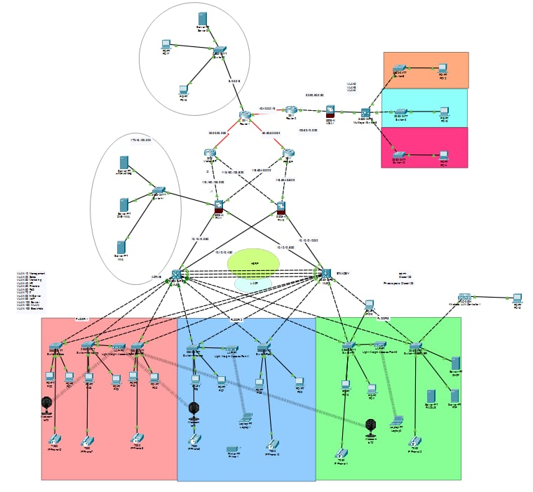
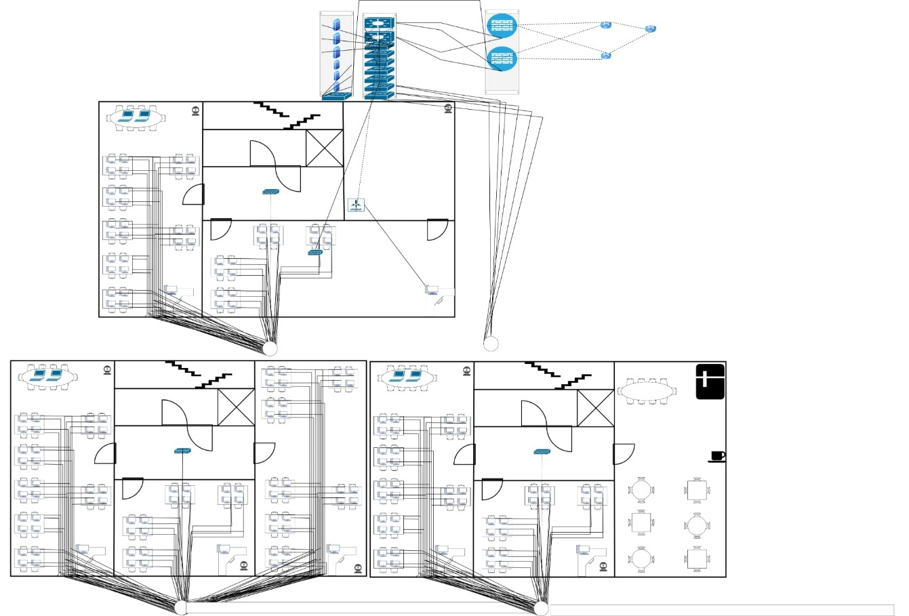

# GTM — Thiết kế mạng doanh nghiệp

Đồ án thiết kế và triển khai hệ thống mạng máy tính cho một doanh nghiệp phân phối hàng tiêu dùng.

## Nội dung

| Tệp | Mô tả |
| --- | --- |
| [52400079_52400066.docx](52400079_52400066.docx) | Báo cáo cuối kỳ |
| [52400079_52400066.pptx](52400079_52400066.pptx) | Slide thuyết trình |
| [Network.pkt](Network.pkt) | Tệp mô phỏng mạng, mở bằng Cisco Packet Tracer |
| [Logical.jpg](Logical.jpg) | Sơ đồ mạng logic |
| [Physical.jpg](Physical.jpg) | Sơ đồ mạng vật lý |

## Xem dự án

Tải dự án về máy để mở báo cáo, slide và tệp mô phỏng bằng phần mềm tương ứng.

### Sơ đồ logic

### Sơ đồ vật lý

